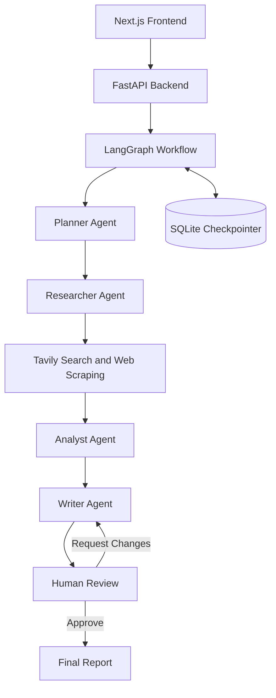

# Multi-Agent Researcher

An AI-powered research report generator that uses a multi-agent workflow to research a topic, analyze findings, and produce structured reports with human-in-the-loop review and revision.

## Features

- **Multi-agent workflow** — separates planning, research, analysis, and report writing.
- **Web research** — searches for relevant sources and extracts useful information.
- **AI-generated reports** — turns research findings into structured Markdown reports.
- **Human-in-the-loop review** — approve a report or reject it with feedback.
- **Iterative revisions** — incorporates reviewer feedback before final approval.
- **Persistent workflow state** — uses LangGraph checkpointing with SQLite.
- **REST API** — exposes research and review operations through FastAPI.
- **Minimal web interface** — built with Next.js, TypeScript, and Tailwind CSS.

## Architecture



## Tech Stack

### Frontend
- Next.js App Router
- React
- TypeScript
- Tailwind CSS
- React Markdown
- Remark GFM

### Backend
- Python
- FastAPI
- LangGraph
- LangChain
- Groq API
- Tavily Search
- SQLite checkpointing

## Project Structure

```text
multi-agent-researcherr/
├── backend/
│   ├── src/
│   │   └── app/
│   │       ├── main.py
│   │       ├── graph.py
│   │       ├── agents/
│   │       ├── tools/
│   │       └── config/
│   ├── pyproject.toml
│   ├── uv.lock
│   └── .env.example
├── frontend/
│   ├── app/
│   ├── components/
│   ├── lib/
│   ├── package.json
│   └── .env.example
├── .gitignore
└── README.md
```

## Prerequisites

- Python version compatible with the backend dependencies
- [uv](https://docs.astral.sh/uv/)
- Node.js and npm
- A Groq API key
- A Tavily API key

## Getting Started

### 1. Clone the repository

```bash
git clone <YOUR_GITHUB_REPOSITORY_URL>
cd multi-agent-researcherr
```

### 2. Configure the backend

```bash
cd backend
uv sync
```

Create a `.env` file using `.env.example` and add the required API keys and configuration.

Example:

```env
GROQ_API_KEY=your_groq_api_key
TAVILY_API_KEY=your_tavily_api_key
CORS_ALLOWED_ORIGINS=http://localhost:3000,http://127.0.0.1:3000
```

Use the exact environment variable names expected by the backend configuration.

Start the API server:

```bash
uv run uvicorn app.main:app --reload --port 8000 --app-dir src
```

Backend API: `http://localhost:8000`

Interactive API documentation: `http://localhost:8000/docs`

### 3. Configure the frontend

Open another terminal:

```bash
cd frontend
npm install
```

Create `.env.local` using `.env.example`:

```env
NEXT_PUBLIC_API_URL=http://localhost:8000
```

Start the development server:

```bash
npm run dev
```

Frontend: `http://localhost:3000`

## API Endpoints

| Method | Endpoint | Description |
|---|---|---|
| `GET` | `/health` | Check API health |
| `POST` | `/research` | Start a research workflow |
| `POST` | `/research/review` | Approve or request report revisions |
| `GET` | `/research/{thread_id}` | Retrieve workflow status |
| `GET` | `/research/{thread_id}/report` | Retrieve a generated report |

### Start Research

`POST /research`

```json
{
  "topic": "How AI agents are changing software development"
}
```

### Review a Report

`POST /research/review`

Approve a report:

```json
{
  "thread_id": "your-thread-id",
  "approved": true,
  "feedback": ""
}
```

Request changes:

```json
{
  "thread_id": "your-thread-id",
  "approved": false,
  "feedback": "Add more recent evidence and improve the comparison."
}
```

The backend may return additional fields depending on the workflow state.

## Deployment

The application can be deployed as two services:

- **Frontend:** Vercel
- **Backend:** Render

Configure `NEXT_PUBLIC_API_URL` on Vercel to point to the deployed backend URL. Configure `CORS_ALLOWED_ORIGINS` on the backend to include the deployed frontend origin.

Keep API keys in the hosting provider's environment settings. Never commit real credentials to GitHub.

**Persistence note:** SQLite checkpoints stored on an ephemeral filesystem may be lost when the backend restarts or redeploys. Configure persistent storage or a suitable external database if workflow state must survive deployments.

## Current Limitations

- Research quality depends on external search results and the selected language model.
- API rate limits and usage quotas may affect report generation.
- Workflow checkpoint persistence depends on the configured storage.
- Full production deployment should include appropriate error handling, logging, and monitoring.

## Future Improvements

- Streaming research progress
- More robust source attribution and citation verification
- Authentication and user-specific report history
- Persistent production database
- Automated tests for the full research and review workflow
- Export reports to PDF or other formats

## License

Choose a license before distributing this project publicly. If no license is specified, standard copyright restrictions apply.
